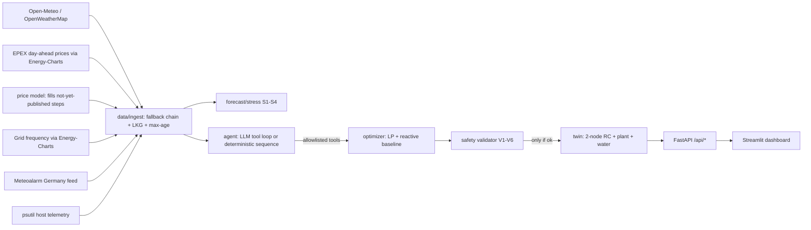

# GridSentinel Preemptive Controller

Autonomous, preemptive cooling controller for a data center in **Frankfurt am Main, Germany** (bidding zone DE-LU). It ingests **live** weather,
15-minute EPEX day-ahead electricity prices, live grid frequency, weather-warning text and real host telemetry; forecasts 12 hours; finds stress windows; computes a plan with a deterministic optimizer (LP / receding horizon);
validates every action with a deterministic safety validator; and applies it to a **physics-based digital twin — `SIMULATED ACTUATOR`**.
An LLM agent orchestrates the tools and parses alerts; **it never sets numbers**.

> **SIMULATED ACTUATOR.** The facility is a digital twin. Nothing here controls real hardware.

## Architecture

Folders: `config/ data/ forecast/ twin/ optimizer/ safety/ agent/ api/ ui/ tests/`. All LLM access is in `agent/llm.py`.

## Setup
```bash
python -m venv .venv && source .venv/bin/activate
pip install -r requirements.txt
cp .env.example .env      # Frankfurt defaults are filled in; set OPERATOR_TOKEN (>= 8 chars)
python fetch_history.py   # optional: the backend also downloads 35 days of real price history on first use
```
**Before relying on the numbers** (the app refuses to invent data):
1. **Price adder:** `market.price_adder_eur_per_kwh` in `config/constants.yaml` (grid fees, Stromsteuer, levies on top of the spot price) is an assumption. Replace it with the figure from your supply contract.
2. **Calibrate `config/constants.yaml`:** every `assumed` constant is a team assumption (listed in the UI). Replace with cited/derived values for your facility.
3. Optional: `OPENWEATHER_API_KEY` (fallback) and `LLM_*` (`LLM_MODEL` is required for LLM mode; `LLM_BASE_URL` for non-Groq/OpenAI providers). Without an LLM the app runs in deterministic mode (E7). Another European bidding zone works by changing `BIDDING_ZONE`, `FACILITY_*` and `ALERT_FEED_URL`.

## Run
```bash
set -a; source .env; set +a
uvicorn api.main:app_factory --factory --port 8000      # backend
streamlit run ui/app.py                                # dashboard (needs OPERATOR_TOKEN, API_BASE_URL in env)
# or one container: docker build -t gridsentinel . && docker run -p 7860:7860 --env-file .env gridsentinel
```
Streamlit Community Cloud (free, public `*.streamlit.app` link): deploy `ui/app.py` from your GitHub repo with Python 3.12. The dashboard starts the backend itself as a child process on 127.0.0.1:8000 (`BACKEND_AUTOSTART=false` disables this). Put `OPERATOR_TOKEN`, `FACILITY_LAT`, `FACILITY_LON`, `FACILITY_TIMEZONE`, `FACILITY_REGION_NAME` and `ALERT_FEED_URL` in the app's Secrets as quoted top-level TOML strings; Streamlit exposes them as environment variables.
GitHub Codespaces: add `OPERATOR_TOKEN` as a Codespaces secret, then create a codespace. `.devcontainer/` installs the dependencies and starts both processes; the dashboard opens on port 7860. Keep that port private, because the dashboard has no login.
Hugging Face Spaces: Docker Space (the header at the top of this file configures it); set `OPERATOR_TOKEN` and `LLM_API_KEY` as secrets, and `FACILITY_LAT`, `FACILITY_LON`, `FACILITY_TIMEZONE`, `FACILITY_REGION_NAME` and `ALERT_FEED_URL` as variables. The dashboard has no login, so anyone with a public link can operate the controller. The disk is ephemeral, so cold start without network is a supported state (E17).

## Test
```bash
python -m pytest tests -q      # UT1-UT10 + AC/E/scenario/market tests; fully offline (inputs are built inside tests/ only)
```

## Verified against live services (2026-11-01, Frankfurt)
Open-Meteo `minutely_15`, Energy-Charts `/price` (DE-LU, 15-min) and `/frequency`, and the Meteoalarm Germany Atom feed all returned LIVE data, and a full cycle completed.
**Still unverified:** Open-Meteo archive (backtest), OpenWeatherMap fallback, LLM base URL / model / tool-calling behaviour.

## Measured results (fill from YOUR runs — none are claimed here)
| Metric | Value |
|---|---|
| Backtest MAE: persistence / same-hour-yesterday / mean-prev-3-days | _run `GET /api/forecast/backtest`_ |
| Spot price model, held-out MAE over 7 days (DE-LU, Oct 25-Nov 1 2026) | same_time_yesterday 0.056, profile_plus_level 0.068, random_forest 0.074 €/kWh. The naive baseline wins and is used. |
| Runtime per cycle (ms) | _see `GET /api/performance`_ |
| Memory (MB) | _see `GET /api/performance`_ |
| Cost / peak / water: reactive vs preemptive | _from your live cycles (dashboard comparison)_ |

## Data sources
| Input | Source | signal_kind |
|---|---|---|
| Weather | Open-Meteo (primary), OpenWeatherMap (fallback; no radiation invented) | MEASURED (wet-bulb MODEL_DERIVED) |
| Price | EPEX day-ahead spot DE-LU via [Energy-Charts](https://api.energy-charts.info) (Bundesnetzagentur / SMARD.de, CC BY 4.0) + fixed adder | PUBLISHED_SCHEDULE; per-step `price_kind`: `day_ahead`, or `forecast_ml` / `forecast_yesterday` for steps not yet published |
| Grid signal | Continental-Europe frequency via Energy-Charts, as mHz below 50 Hz; S2 uses the app's own stored observations (7 days) | MEASURED |
| Alerts | Meteoalarm Germany Atom feed (`ALERT_FEED_URL`) | MEASURED |
| IT load | psutil on the **backend host** (labeled `backend_host:<name>`), mapped to kW by a documented formula | MEASURED → MODEL_DERIVED |

## Design decisions to know before judging
- Prices: the next day's auction result is published ~12:45 CET, so almost every step of a 12-hour horizon has a real published price. Only unpublished steps use the price model; each step records which source it came from (`price_kind`). S1 = spot at/above the 75th percentile of the previous 7 days. German spot prices can go negative, and the optimizer handles negative prices.
- Price model (`forecast/predictor.py`): candidates use published lags (1 day, 7 days, yesterday's mean level), and the winner is chosen by a 7-day walk-forward MAE. Time-of-day alone fails because price levels swing up to 20× between days with wind/solar.
- Exact (matrix-exponential) discretisation: explicit Euler would be unstable for the default constants (dt/(C_air·R_mass) ≈ 1.13).
- Optimizer is an LP (HiGHS via SciPy), so cooling is two continuous variables (mechanical, evaporative); mode is derived. Relaxation order: peak cap → water budget → recommended maximum; hard limits (18–27 °C) never.
- Fair comparison: the plan's final thermal-mass temperature may not be warmer than the baseline's.
- Validator is the only gate to the twin; `execute_step` re-validates even if the agent already did. Plan hashes stop edited plans (V1).
- Telemetry is re-sampled when an action is applied; a >1.0 °C deviation from the prediction triggers rollback (E15).
- Twin state changes only when an action is applied; holding the safe state leaves it unchanged.

## Limitations
Digital twin, not hardware. Constants are assumptions until calibrated. The envelope resistance was raised to 0.2 °C/kW (an insulated hall); with the old 0.05 a Frankfurt winter cooled the hall below 18 °C, and with no heating model every cycle held the safe state. The price adder is a single flat assumption. Alert relevance needs `FACILITY_REGION_NAME`. The generic "demo data" lines in the spec-builder template were intentionally **not** followed (Q9 forbids dummy data).
