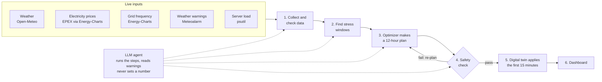

# GridSentinel

**We cool the data center before the grid heats up.**

GridSentinel is a cooling controller for a data center in Frankfurt, Germany. It looks 12 hours ahead at the weather, electricity prices and the state of the power grid. It then plans when to cool, so the servers stay between 18 and 27 °C at the lowest cost. It cools a little extra while power is cheap and eases off while power is expensive or the grid is under stress.

> **Simulated.** The data center is a physics-based *digital twin*. All inputs are live, but nothing here controls real hardware.

## How it works

Every 15 minutes the controller runs one cycle:



| Step | What happens |
|---|---|
| 1. Collect data | Fetches weather, prices, grid frequency, warnings and server load. Each source has a backup. If a source is down, recent data is used with a 1 °C extra safety margin. If there is no usable data, the cycle **holds the current safe state**. No value is ever made up. |
| 2. Stress windows | Flags the risky 15-minute slots: **S1** price in the top 25 % of the last 7 days, **S2** grid frequency unusually low, **S3** an official warning for the region, **S4** cooling plant close to its limit. |
| 3. Optimizer | Solves one linear program that picks chiller and evaporative cooling for all 48 slots, minimising electricity + water + peak-demand cost within every limit. |
| 4. Safety check | A separate rule checker must approve the plan (rules **V1–V6**: plan not edited, cooling within capacity, 18–27 °C, no sudden temperature or cooling jumps, a full re-simulation stays safe, no essential input missing). If it fails, the plan is redone (up to 2 times) with a bigger margin. |
| 5. Digital twin | Applies only the first 15 minutes. If the result differs from the prediction by more than 1 °C, the step is undone. |
| 6. Dashboard | Shows live data health, the plan vs. a simple thermostat, the decision trace, and approve / reject buttons. |

Only the first 15 minutes of each plan are used. The plan is redone every cycle with fresh data, so a wrong forecast only costs one step. This is called *model predictive control*.

## Key ideas (and why)

- **The building is a thermal battery.** The concrete, racks and floor hold a lot of heat. Cooling them by 1 °C stores about 140 kWh of "coolness", which takes about 29 kWh of electricity. The optimizer stores this coolness while power is cheap and uses it up when power is expensive.
- **The LLM never sets numbers.** It only (1) calls the steps in order from a fixed list of allowed tools, (2) turns warning text into structured alerts, which are checked against a strict format and retried if invalid, and (3) shows a grid-risk badge on the dashboard. The optimizer computes every number and the safety check must approve it. Without an LLM key, the same steps run in a fixed order.
- **Why a linear program?** It always finds the best plan within the rules, solves in milliseconds, and every number can be explained. Chiller efficiency depends on the *forecast* outdoor temperature, which is already known, so the problem stays linear.
- **Two kinds of cooling.** The chiller always works but uses more electricity, and it gets less efficient when it is hot outside. Evaporative cooling is about 2–3× more efficient but uses water and works poorly in humid air. The optimizer mixes them within a 6000 L water budget.
- **Fair comparison.** Every plan is compared with a simple thermostat that just holds 25 °C. The plan may not end the 12 hours with a warmer building than the thermostat would, so it cannot look cheaper by "spending" stored coolness.
- **Negative prices work.** German prices sometimes go below zero when there is a lot of wind and solar. Nothing forces prices to be positive, so a negative price simply makes pre-cooling attractive.

## The thermal model

The hall is two connected parts: the **air**, which reacts within minutes, and the **building mass**, which reacts over hours. For each part, heat in minus heat out sets how fast its temperature changes:

- air gains heat from the servers, from outdoors (through the walls) and from the mass, and loses heat to the cooling;
- the mass only exchanges heat with the air.

The twin advances these equations exactly in 15-minute steps, using a matrix exponential. A simpler step-by-step method (Euler) would make the air temperature swing back and forth unrealistically, because the air reacts faster than one 15-minute step.

## Electricity prices

Price = EPEX day-ahead spot price + 0.08 €/kWh (an assumed figure for grid fees and taxes). The next day's prices are published around 12:45 each day, so most of the 12 hours already has real prices. For slots that are not yet published, three models compete on the last 7 days of real data, and the most accurate one fills the gap:

| Model | Error on the last 7 days (MAE, €/kWh) |
|---|---|
| **Same time yesterday** (used) | **0.045** |
| Typical daily shape + yesterday's level | 0.056 |
| Random forest | 0.065 |

*(DE-LU data up to 2 Nov 2026.)* The simplest model wins because German prices swing with wind and solar output, which none of the models see yet. The LLM is not used to predict prices.

## Tech stack

| Part | Choice | Why |
|---|---|---|
| Backend | Python 3.12, FastAPI | Typed REST API, plus a live event stream for the decision trace |
| Dashboard | Streamlit | Fast to build; talks to the backend only over HTTP |
| Optimizer | SciPy `linprog` with HiGHS | Open-source LP solver, guaranteed best answer, milliseconds |
| ML | scikit-learn, pandas, NumPy | Price models and data handling |
| Database | SQLite | One file for last-known-good data, plans, actions and twin state |
| LLM | Any OpenAI-compatible API (Groq by default) | Tool calling; optional |
| Deploy | Docker, Hugging Face Spaces | One container runs backend and dashboard |

Code layout: `data/` inputs · `forecast/` stress windows and price model · `twin/` thermal model · `optimizer/` plan · `safety/` checks · `agent/` LLM and tools · `api/` backend · `ui/` dashboard · `config/constants.yaml` all model constants.

## Data sources

| Input | Source |
|---|---|
| Weather | Open-Meteo (backup: OpenWeatherMap) |
| Electricity prices | EPEX day-ahead, DE-LU, via [Energy-Charts](https://api.energy-charts.info) (data: Bundesnetzagentur / SMARD.de, CC BY 4.0) |
| Grid frequency | Energy-Charts (Continental Europe) |
| Weather warnings | Meteoalarm Germany feed |
| Server load | `psutil` CPU and RAM of the backend machine, converted to kW of server heat |

Every value is labelled with its source, time and status (LIVE, FALLBACK_LIVE, STALE or FAILED).

## Run it

```bash
python -m venv .venv && source .venv/bin/activate
pip install -r requirements.txt
cp .env.example .env            # Frankfurt defaults; set OPERATOR_TOKEN (at least 8 characters)
set -a; source .env; set +a

./start.sh                      # backend on :8000 + dashboard on :7860
# or separately:
uvicorn api.main:app_factory --factory --port 8000
streamlit run ui/app.py
```

Optional settings: `LLM_API_KEY` and `LLM_MODEL` for LLM mode, and `OPENWEATHER_API_KEY` for the backup weather source. Price history downloads automatically (or run `python fetch_history.py`).

**Docker / Hugging Face Spaces:** `docker build -t gridsentinel . && docker run -p 7860:7860 --env-file .env gridsentinel`. On a Space, set `OPERATOR_TOKEN` and `LLM_API_KEY` as secrets. The dashboard has no login, so keep the link private.

**Tests:** `python -m pytest tests -q`. All 42 tests run offline (twin, optimizer, safety rules, data fallbacks, agent, API).

## Results

- Price model: see the table above.
- Cost, peak power and water (plan vs. simple thermostat): shown on the dashboard for every cycle. Savings depend on the day's prices and weather, so no fixed figure is claimed here.
- Runtime and memory per cycle: `GET /api/performance`.

## Limitations

- It is a simulation; nothing controls real hardware.
- Building and plant constants (in `config/constants.yaml`) are team assumptions until calibrated on a real site; each one is marked *assumed* and listed in the dashboard.
- There is no heating model. The wall insulation value was raised so a Frankfurt winter does not push the hall below 18 °C.
- The price adder is a single flat estimate, not a real supply contract.
- Server load is taken from the latest reading and held constant for the 12 hours.
- The price model has no wind or solar input yet; adding it is the next step.
